  

# Hi, I'm Juanlu 👋

**Software developer. Curious by nature. Always looking for ways to make things work better.**

I work mainly with **Java, Python, and TypeScript**, with a particular interest in **machine learning, security, and performance optimization**.

I like digging into how systems work, finding bottlenecks, and building tools that save effort. Away from application code, you'll often find me tinkering with **Linux, self-hosted services, and home automation**.

## 🧠 What I like exploring

<table>
  <tr>
    <td width="50%"><strong>Machine learning &amp; AI</strong> Neural networks, reinforcement learning, emergent behaviour.</td>
    <td width="50%"><strong>Performance &amp; efficiency</strong> Profiling, algorithms, getting more out of hardware.</td>
  </tr>
  <tr>
    <td><strong>Security</strong> Vulnerabilities, attack surfaces, resilient software.</td>
    <td><strong>Developer tools &amp; agents</strong> Coding agents, reusable tools, useful automation.</td>
  </tr>
  <tr>
    <td><strong>Linux &amp; self-hosting</strong> My own services, my hardware, my setup.</td>
    <td><strong>Home automation</strong> Connected devices, integrations, smarter routines.</td>
  </tr>
</table>

## 🛠 Languages & tools

**Languages**

  <picture>
    <source media="(prefers-color-scheme: dark)" srcset="assets/language-icons-dark.svg" />
    
  </picture>

**Application development & infrastructure**

  <picture>
    <source media="(prefers-color-scheme: dark)" srcset="assets/tool-icons-dark.svg" />
    
  </picture>

## 📊 GitHub activity

  <picture>
    <source media="(prefers-color-scheme: dark)" srcset="assets/stats-dark.svg" />
    
  </picture>
  <picture>
    <source media="(prefers-color-scheme: dark)" srcset="assets/languages-dark.svg" />
    
  </picture>

Language usage reflects repository code, rather than proficiency.

## 🐍 A year of contributions

<picture>
  <source media="(prefers-color-scheme: dark)" srcset="assets/snake-dark.svg" />
  
</picture>
